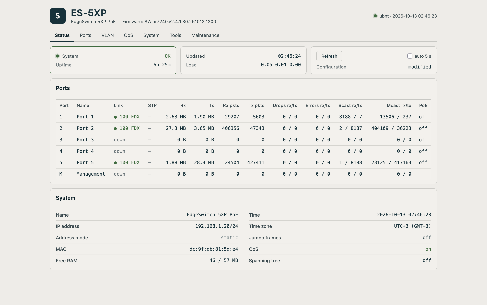
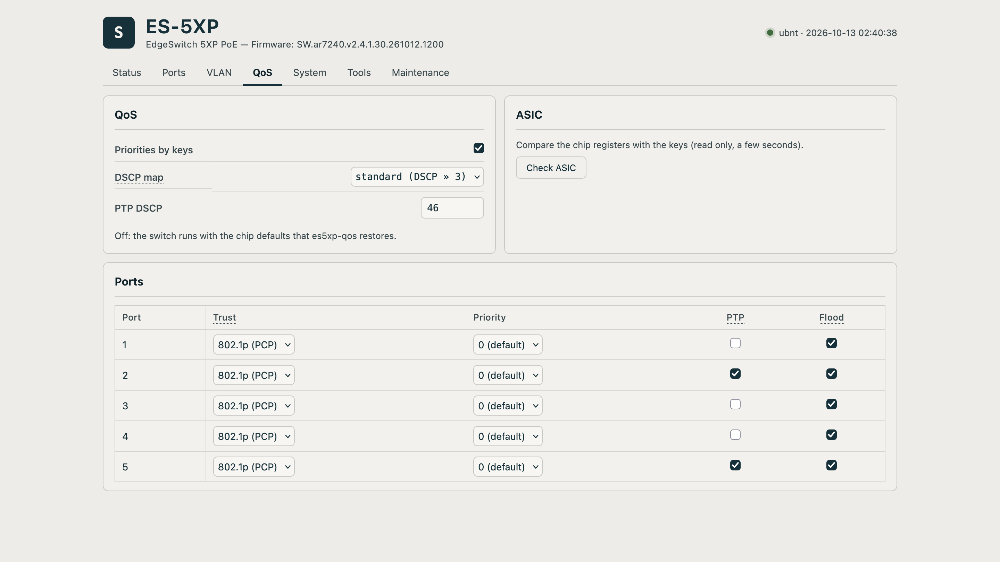
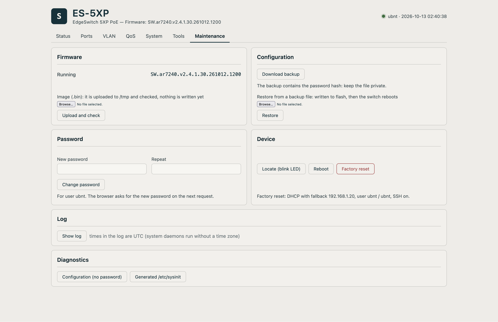

# es5xp – firmware for the Ubiquiti EdgeSwitch 5XP, built on the vendor's 2.4.1

> "To the man with a hammer, it is said, all things look like nails."
> – **Henry Marsh**, *Do No Harm: Stories of Life, Death and Brain Surgery*

## 1. Introduction

While testing my [Ramliya](https://github.com/Spearfun/Ramliya) project (a PTP grandmaster and Stratum-1 NTP server) on the measurement bench, the Ubiquiti EdgeSwitch 5XP (ES-5XP, formerly the UBNT ToughSwitch 5 POE) turned out to have the best delay and stability of all the cheap switches I tried:

| Switch | `delay` spread | offset std dev, ns | ADEV τ=1 s | within ±100 ns |
|---|---|---|---|---|
| **Ubiquiti EdgeSwitch 5XP** | **±14.8 ns** | **55.0** | **8.70e-08** | **93.5 %** |
| TP-Link TL-SG108 (1 Gbit/s) | ±25.6 ns | 99.7 | 1.58e-07 | 60.1 % |
| D-Link DGS-1100-05 (1 Gbit/s) | ±20-46 ns | 102-108 | – | – |
| TP-Link unmanaged (100 Mbit/s) | ±30-31 ns | 114-129 | 1.82e-07 | 55 % |
| *direct cable (reference)* | *±0.8 ns* | *7.8* | *1.16e-08* | – |

<sub>Measurement conditions: linuxptp, UDPv4, 100 Mbit/s, kernel 6.12 RT on the server and 5.10 on the client; excluding intervals of deliberate disturbance. The hardware of the bench is described in the Ramliya project. Confirmed in practice: replacing the TL-SG108 with the ES-5XP on a running client brought the rms offset down from 98-100 to 51-58 ns. The D-Link DGS-1100 is not quite an unmanaged switch (Easy Smart, it does prioritize).</sub>

According to the switch specification it has an Atheros AR8327 ASIC inside, and the AR8327 datasheet says this ASIC can do a good deal more than the vendor firmware exposes to the user: frame priorities, ACLs, static ARL entries, control over broadcast and unknown flooding. All of that exists in silicon and can be controlled – the vendor `swconfig` exists for exactly that. It is simply that none of these mechanisms made it into the vendor web interface: to use them you have to read the ASIC datasheet and write the registers yourself. That is what became the starting point of this project.

Studying the latest version of the vendor firmware for this switch (2.4.1.7, 15 July 2026), I found that besides getting direct control over the ASIC I could also make the firmware simpler and faster: most of the vendor userspace (cloud management, NMS integration, analytics, IPv6 support, superfluous internal system services) turned out to be of no use to me on a switch that works as a node of PTP/NTP infrastructure.

What came out of it is an image that installs through the ordinary vendor web interface and goes back the same way. The vendor kernel, bootloader and device tree are left untouched – only the root filesystem changes. All the sources of my changes, together with a way to rebuild the firmware automatically, are in this repository.

### What you get

- traffic priorities right in the ASIC: PTP frames at the highest priority, a DSCP map, per-port trust of tags, per-port control of broadcast and unknown flooding – what the AR8327 can do but the vendor web interface does not show;
- boot to a reachable management address in 12.4 s instead of 21.2 s;
- a web interface of its own, with no cloud and no registration, on port 8080: status, ports, VLANs and the management VLAN, port isolation, mirroring, storm control, STP, QoS, PoE, MAC and ARP tables, diagnostics, firmware upgrade;
- a squashfs of 2.6 MB instead of 4.8 MB, and a handful of system services that no longer take memory and CPU time – I do not need them on a PTP/NTP node, but check the list below: you might;
- configuration from shell scripts and a plain text config, with no UDAPI and no layers in between.

### What you lose

This firmware is for a switch in an internal network segment doing one particular job; read the section on limitations carefully and treat security seriously. If you need anything from the list below, stay on the stock firmware:

- UISP/UNMS cloud management and the Ubiquiti mobile app;
- SNMP, DDNS, network discovery (CDP/LLDP), crash reporting;
- the PoE watchdog (power-cycling a port when pings stop) and per-port rate limiting – PoE 24 V itself works and is controlled from the web interface;
- DHCP snooping, and restricting management to a single port (Management Port Only);
- HTTPS in the web interface and management over IPv6;
- the vendor web sessions and everything tied to them in the UniFi world.

In exchange you can go back at any moment: the stock firmware image installs through the web interface, with no soldering iron, no UART and no TFTP. The configuration and the SSH keys survive it.

## 2. How the vendor firmware is built

This section is for those curious about how the firmware is put together inside, and for anyone who wants to do something similar for another model. All offsets are for the ES-5XP and firmware 2.4.1.

### 2.1 The UBNT container

The firmware file is assembled by the vendor's `mkfwimage` utility and is simple enough:

- a 268-byte header: the magic `UBNT`, the version string (256 bytes), a CRC and padding;
- then the blocks, each with its own 56-byte header and a CRC32 of its contents. The `PART` blocks are `u-boot`, `kernel` and `rootfs`; the `EXEC` block is `script`;
- the file ends with an `END.` block carrying a CRC32 of the whole file.

The container is not signed – only the magic and the CRCs are checked. That is precisely why the image can be assembled again and the vendor web interface will accept it. Taking it apart and putting it back together is the job of `tools/fwimage.py` (`info`, `extract`, `build`, `check`).

### 2.2 The MTD map of the original firmware (`cat /proc/mtd`)

8 MiB of flash:

| mtd | name | offset | size | purpose |
|---|---|---|---|---|
| mtd0 | u-boot | `0x000000` | `0x040000` | bootloader |
| mtd1 | u-boot-env | `0x040000` | `0x010000` | U-Boot variables |
| mtd2 | kernel | `0x050000` | `0x100000` | the first megabyte of the kernel uImage |
| mtd3 | rootfs | `0x150000` | `0x660000` | the rest of the kernel + squashfs |
| mtd4 | cfg | `0x7B0000` | `0x040000` | configuration, two slots |
| mtd5 | EEPROM | `0x7F0000` | `0x010000` | board id, MAC addresses |
| mtd6 | rootfs.real | `0x2D0000` | `0x4E0000` | the squashfs itself |

The details that matter:

- the kernel uImage does not fit into `kernel` and is cut at the 1 MiB boundary: the beginning goes into PART `kernel`, the remainder into the start of PART `rootfs`. PART `rootfs` itself is `0x180000` bytes (the tail of the kernel and zeroes) plus the squashfs. In flash the squashfs starts at `0x2D0000` and its slot is `0x4E0000`, a little under 5 MiB;
- the `cfg` partition holds two slots in an A/B scheme: `cfgmtd -w` writes the new version into whichever slot was the backup and marks it active, and the former active one becomes the backup. So the backup is the previous version of the configuration, not a mirror of the current one;
- the `EEPROM` holds the board id (`0xe700` on the ES-5XP) and the MAC addresses. This partition must never be touched: it cannot be restored from a firmware image.

### 2.3 How to extract the kernel, the DT and the rootfs

- **Kernel.** Concatenate PART `kernel` with the first `0x180000 − 0x100000` bytes of PART `rootfs` and you get a uImage: LZMA compression, load address and entry point `0x80060000`, Linux 6.12.71.
- **Device tree.** The unpacked kernel (6,782,578 bytes, sha256 `a83b70ce…`) contains three flattened device trees, found by the magic `d00dfeed` (format version 17):

  | offset in the kernel | size | what it is |
  |---|---|---|
  | `0x655b44` | 2115 (`0x843`) bytes | the **ES-5XP** overlay: `ubnt,edgeswitch-5xp`, "Ubiquiti EdgeSwitch 5XP", a `qca,ar8327` switch on mdio, `poe-control` |
  | `0x665b44` | 2795 (`0xaeb`) bytes | the **ES-8XP** overlay: `ubnt,edgeswitch-8xp`, "Ubiquiti EdgeSwitch 8XP", a `brcm,bcm53128` switch (`ethernet-switch@1e`), ports `lan1`-`lan8`, `poe-control` |
  | `0x675b64` | 8974 (`0x230e`) bytes | the base DTB: `compatible = "qca,ar7242"`, `model = "Ubiquiti Networks SW board"`; nodes `ahb`, `cpus`, `leds`, `keys`, `gpio_spi`, `reserved-memory` and others |

  The kernel applies one of the overlays onto the base DTB through `of_overlay_fdt_apply`, choosing it by the board id from the `EEPROM`; the debug strings "`dtb overlay offset: %x`" and "`Dtb_overlay not present`" are even still in there. That is how a single kernel image serves both models: the ES-5XP on the AR8327 and the ES-8XP on the Broadcom BCM53128 – which is where the `b53` and `dsa` modules in the firmware come from. Which overlay belongs to which model follows from the `compatible` and `model` properties inside the trees themselves; the mapping from id to overlay lives in the kernel code rather than in the tree, and I did not work out the id for the ES-8XP – the vendor kernel and DT are not modified in this project.
- **Rootfs.** A squashfs (xz, 256 KiB block) at offset `0x180000` inside PART `rootfs`.

The kernel and the rootfs are extracted by `tools/fwimage.py extract IMAGE DIR`, and the trees are found by `tools/dtbscan.py UIMAGE [DIR]`: it decompresses the LZMA, lists every tree and, when given a `DIR`, saves each one as a separate `.dtb` – which you can then read with an ordinary `dtc`.

### 2.4 The `EXEC` block and the version string

The fourth block of the container, right after PART `rootfs`, is an `EXEC` named `script`: a gzip archive holding a tar with the single file `bin/preflash` (a static MIPS binary). During an installation `fwupdate`, which the vendor web interface calls, unpacks it into `/tmp` and runs it **before** writing any partition; a non-zero exit code aborts the installation.

What it checks turned out to be very little: `preflash` reads `/usr/lib/version` of the **running** system, parses it with the pattern `%[^v]v%d.%d.%d` – a prefix, then three numbers – and by that version decides what to do with U-Boot. It checks neither a signature, nor the model, nor the contents of the new rootfs. Separately, `fwupdate` compares the three numbers of the new image with a required minimum.

That is why I did not change the versioning scheme: the prefix and `2.4.1` stay as they are, so that the `preflash` of any image installed later – the stock one during a rollback included – reads the running system as `2.4.1` and takes exactly the same U-Boot path as a reinstall of the stock firmware (the rollback has been tested). Only the build number is mine: the firmware is called `SW.ar7240.v2.4.1.<build>.<YYMMDD>.<HHMM>`, for example `SW.ar7240.v2.4.1.30.261012.1200`.

### 2.5 The boot order

U-Boot (`bootcmd = bootm 0x9f050000`, a CRC check of the uImage) → the kernel, with the command line `console=ttyS0,115200n8 rootfstype=squashfs,jffs2 root=/dev/mtdblock6` → `/init` (an ordinary shell script: it mounts the filesystems, restores `/etc` from the configuration and runs the config generator `ubntconf`) → `/sbin/init` → `rc.sysinit` → the `rc_start` plugins.

### 2.6 The three layers of the firmware

1. **The base layer:** U-Boot, the kernel, the drivers and the modules;
2. **The system:** `ubntbox` (a single binary with many commands, the configuration generator among them), the vendor utilities – `swconfig`, `cfgmtd`, `ubntconf`, `mstpctl`, `garp`, `preflash` – and the rc scripts;
3. **Management:** UDAPI (`udapi-server`, `udapi-bridge`), the `www-ui` web interface, the cloud client, network discovery.

The base layer stays the vendor's, unchanged; the system I modify (some vendor utilities are kept, some are replaced with my own); the management layer is replaced entirely.

### 2.7 The filesystem: what lives where, and what survives a reboot

The root is a **read-only** squashfs; nothing can be written into it. Everything mutable lives in RAM: `/init` mounts a 9 MiB tmpfs on `/var`, and `/etc`, `/tmp` and `/run` are symlinks into `/var`. Which means they are empty on every boot and `/etc` is assembled anew: `/init` copies `inittab` and the rc scripts from `/usr/etc`, and `cfgmtd -r` unpacks the saved configuration into it.

The one place that survives a reboot is **`/etc/persistent`**. It holds the dropbear host keys, the certificate and key the vendor web server used for HTTPS (left in place, though this firmware does not serve HTTPS), and any files of your own. When the configuration is saved, `cfgmtd` packs the whole directory into a tar.gz, puts it together with the text of `system.cfg`, compresses the lot with zlib and writes it into the `cfg` partition – so the contents of `/etc/persistent` are stored in flash along with the configuration and come back from there on boot. There is no encryption here, only compression.

Two subtleties worth knowing, both learned the hard way:

- files **directly** in `/etc/persistent` named `rc.<hook>` are deleted on boot (the list of names is built into `ubntbox` – it looks like a leftover of the fight against the 2016 airOS worm). **Subdirectories** under `/etc/persistent/` are left alone, however. That is why the hooks in this firmware live in `/etc/persistent/hooks/`;
- a reset to factory settings writes the configuration without the `-p` option, so `/etc/persistent` is empty afterwards: new SSH host keys are generated and your own files and hooks are gone.

And a practical consequence of the tmpfs size: `/tmp` is those same 9 MiB, and a firmware image uploaded through the web interface is written there in full. An image takes 5.5-7.6 MiB, so it is worth a look at `df -h /tmp` before an upgrade, and anything copied onto the switch for testing should be deleted from there.

### 2.8 The configuration

The main file is `/tmp/system.cfg`: plain text, lines of the form `key=value`, read and edited as it is. It is the working copy in tmpfs: on boot `cfgmtd -r` pulls the configuration out of flash into `/tmp/running.cfg`, that gets sorted into `/tmp/system.cfg`, and the `ubntconf` generator builds the working configurations of the services from it. An edit in `/tmp/system.cfg` lasts until the next reboot, until it is saved into flash.

Changes are applied either in softrestart mode (restarting the affected plugins) or in fastrestart mode (`diff.sh`, a list of what changed). Exactly one line in the whole configuration is encrypted – `~META~`, which holds the user password (AES-256-GCM, the key derived from the flash UID). On every write to flash `cfgmtd -w` re-encrypts it, so the line looks different every time – and two configurations have to be compared without it, or it will look as if something important has changed.

## 3. Why not OpenWrt

- The vendor kernel with its own drivers and the vendor DT stay as they are. Only the rootfs changes, so there is no need to port the drivers and the DT to a different kernel.
- The stock firmware remains installable: it can be restored by an ordinary flash through the web interface, with no UART and no TFTP. From OpenWrt the only way back would be a U-Boot recovery.
- The vendor's AR8327 driver gives `swconfig` attributes that OpenWrt does not have: `reg_addr`/`reg_val` (direct access to the ASIC registers), `acl`, `rate_*`, `flow_control`, `protected`; plus `ar8216_vport` (the `lanN` interfaces and `stp-br` for `mstpd`). Priority control rests on exactly these attributes, so the vendor `swconfig` is a requirement here and the OpenWrt version will not do.

## 4. Disclaimer

The firmware is provided as is, without any warranty, at your own risk. The license is GPL-2.0.

| How it is done in this firmware | What to keep in mind |
|---|---|
| Only the ES-5XP has been tested | Not tested on the ES-8XP; the image has no protection against installing it there |
| The web interface listens on port **8080** (the vendor used 80) | Open the management address as `http://<address>:8080` |
| The web interface is HTTP without HTTPS and is reachable from any port of the switch | Do not expose management to an untrusted network |
| SSH is enabled in the factory configuration | Until you change the password the login is `ubnt`/`ubnt` |
| With bridge STP enabled, every full STP start (boot, enabling STP) sends one BPDU out of each port with a link, even where the BPDU filter is set, and there are ~22 s without forwarding (the same as the vendor) | Do not rely on the BPDU filter to keep a port completely BPDU-free at that moment |
| IPv6 is switched off: the configuration keys plus the `disable_ipv6` sysctl on every interface except `lo`; the kernel itself is the vendor's, unchanged | Do not count on IPv6 management |
| After a rollback to stock the ASIC priority registers keep their values | Power the switch off and on |

## 5. What was done and what changed

### 5.1 Removed

182 files and directories:

- the vendor management layer: `udapi-server`, `udapi-bridge`, the `www-ui` web interface, the cloud client, `ubnt-discovery`, crash reporting and analytics (`bin/support`, `oopsdump`), `infctld`;
- SNMP (`tinysnmpd` with its libraries and MIBs), DDNS;
- the PoE watchdog: the vendor applet `pwdog` (power-cycling a port when pings stop); the web interface has no such function either. PoE itself works: the vendor's `/bin/poe` is still there and the Ports page switches 24 V on and off per port. The vendor's `poectrl`, which only `pwdog` needed, is left in the image and simply does nothing. The `switch.port.N.pwdog.*` configuration keys are not touched;
- IPv6 in userspace: `odhcp6c`, `rdisc6`, `rdnssd`, `ping6`, `traceroute6`;
- `ubus` together with `ubusd`;
- leftovers of the shared AirOS code base that the switch firmware does not use: the libraries `libabz`, `libber`, `libdebug`, `libcli`, `libvalidate`, the `counterfeit` utility, `dyndns.inc`, and `htb`, a shaper script for `tc` (which is not even in the image);
- the vendor `ntpclient` with its helpers `ntpcheck.sh`, `ntpclient.sh`, `adjtimex` and `rate.awk` (see 5.8);
- OpenWrt leftovers: `netifd`, `lib/opkg`, `lib/preinit`, `lib/upgrade`, `hotplug2.rules`, `mdev`, `jsonfilter`, `libucode`;
- the kernel modules of the ES-8XP branch (`b53_common`, `b53_mdio`, `dsa_core`, `tag_brcm`, `phylink`) and others that never load on an ES-5XP;
- large libraries left without a consumer: `libcurl`, `libssh`, `libwebsockets`, `libevent`, `mbedtls`, `libjson-c`.

The full list is in `rootfs/remove.txt`, one path per line. It is not a piece of documentation but the very file the build reads, so it always matches the image. Removal goes from the deepest paths upwards and the build stops if a directory is not empty afterwards – so the list is exact and carries nothing extra away with it.

### 5.2 A web interface of its own

Busybox `httpd` with CGI in plain shell, on port 8080. Dangerous changes (the management address, VLANs) are applied with a confirmation: if the confirmation does not arrive, the settings are rolled back by a reboot and access to the switch is not lost.



### 5.3 PTP priorities in the ASIC

`/bin/es5xp-qos` is a shell script. It takes its settings from ordinary configuration keys `qos.*` in `system.cfg` (`qos.status`, `qos.dscp`, `qos.port.N.trust`, `qos.port.N.prio`, `qos.port.N.ptp`, `qos.port.N.flood`), which are set on the QoS page of the web interface or by editing the configuration. The commands: `apply` brings the ASIC to the state the keys describe, `off` returns everything to the default values, `check` only reads and reports the differences. It runs automatically on boot and on every apply of the settings; in the registers it writes `PRI_CTRL`, `TOS_PRI_MAP`, ACL rules 89-95, static ARL entries and the flooding control. One important detail: what is written into the ASIC survives a warm reboot and is only cleared by removing power.



### 5.4 `swbatch`

A utility I wrote for configuring the switch ASIC in batches: a whole batch of commands goes through a single process instead of a series of `swconfig` calls (each of which costs about 20 ms). The `switch` plugin now takes 0.39 s during boot instead of 2.96 s. If `swbatch` does not suit you for some reason, create the flag file `/etc/persistent/es5xp-no-swbatch` and the same work will go line by line through the vendor `swconfig` instead.

### 5.5 The reset button

On the stock firmware it simply did not work – while the system is running there is no handler for the event (checked on the stock firmware). Now it works the way the vendor documentation describes: hold it for 10 s or more → the amber `yellow:usr` LED starts blinking → let go → the switch resets to factory settings and reboots. Implemented with the busybox `uevent` applet and `/bin/es5xp-button`.

### 5.6 Faster boot

Cleaning up `/init` and `rc.sysinit`, dropping `drop_caches` and the deferred-write settings (on a squashfs and a tmpfs they do nothing anyway), reading `/dev/random` early (the kernel gathers entropy while nobody needs it yet), a squashfs with a 64 KiB block, loading the modules with a single `kmodloader`, and `swbatch` – all together this made the boot almost twice as fast up to the point where the management address answers (`br0` forwarding): from 21.15 s with the vendor boot sequence (measured on a diagnostic build with time marks) to 12.39 s, measured on the release build. For a fully configured switch I measured (`rc_start: done`) 24.64 → 13.14 s – that was on intermediate builds, in the release the debug marks are turned off. Any further optimization would be in the vendor's kernel (~2.8 s) and in `ubntconf` with `cfgmtd` (~6.5 s), which I did not change.

### 5.7 Updated components

busybox 1.38.0 and dropbear 2026.94 instead of the vendor builds. The vendor busybox was built with its own set of applets; the new build adds 14 that the vendor did not have: `arp`, `arping`, `base64`, `devmem`, `fuser`, `httpd`, `nmeter`, `ntpd`, `pkill`, `pstree`, `stat`, `timeout`, `uevent`, `watch`. Of these, `httpd` runs the web interface, `uevent` the reset button and `ntpd` the clock, while `devmem` and `nmeter` came in handy while debugging.

Plus wrappers under the vendor names, so that the configuration generator and the rc scripts keep working: `garp`, `killall`, `syslogd` (a ring buffer and `logread`), `mstpctl`.

### 5.8 Time over NTP

The vendor `ntpclient` did not work: it sends a single request per process lifetime, and at boot it starts (at about 13 s) before any external port has a link, so that one request is lost and the clock is never set – the switch went into service with the firmware build time on its clock. Its configuration generator also used only the first enabled server, so a second NTP server in the configuration did nothing. Rather than fix somebody else's binary I replaced it with a script of the same name, `/bin/ntpclient`, which runs the busybox `ntpd` inside. The name was kept on purpose: an `inittab` line and a `killall ntpclient` in the vendor templates refer to it, so from the system's point of view nothing changed. The script takes every server from the `ntpclient.N.server` configuration keys (skipping the disabled ones), so the second one is a real fallback now, waits for a working port – a link, and with STP enabled the forwarding state in the ASIC as well – and only then starts `ntpd`. Time steps, a change of stratum and a loss of synchronization each go into the log as a single line.

### 5.9 Configuration without the web interface (hooks)

Sometimes you want something of your own to run at boot: bring an interface up, add a rule, start your own program. There are six points for that, where the system looks into `/etc/persistent/hooks/` and, if it finds a file with the matching name, executes it as a shell script: `presysinit` and `postsysinit` before and after system initialization, `prestart` and `poststart` before and after the plugins start, `prestop` and `poststop` the same on the way down. Such a file can be created over SSH and needs nothing but a text editor. Since `/etc/persistent` is saved into flash together with the configuration (see 2.7), a hook survives a reboot – but not a reset to factory settings. Two flags work the same way: by creating an empty file named `es5xp-no-swbatch` in `/etc/persistent` you force all work with the ASIC onto the vendor `swconfig`, line by line, with no batch mode; by creating a file named `no-modules` there you turn off loading the modules with a single `kmodloader` and bring back the vendor way, one module at a time from `rc.modules`. Delete the file and the previous behaviour returns.

### 5.10 Untouched

U-Boot, the vendor kernel and modules, the device tree, the configuration format. That is why your configuration and the SSH keys survive the transition in both directions – onto this firmware and back to the stock one.

### 5.11 The `ubntbox` edits

The code of the vendor binary was not changed: the edits touch only the text templates from which `ubntbox` generates `inittab` and the rc scripts. A line is disabled by replacing its first byte with `#`, and the length of the file stays the same. There are 11 edits in all: four `inittab` lines for the removed daemons (`udapi-bridge`, `udapi-server`, `infctld`, `ubnt-discovery`), `killall -SIGHUP udapi-bridge`, the path `/tmp/udapi-bridge.conf` → `/dev/null`, three lines that write `ip_forward` and `conf/all/forwarding`, `killall rdnssd`, and the UBNT beacon line, where the command `ls /tmp/.ubnt_beacon_enabled` is replaced with `: ` – the test now always succeeds, so the branch that started the beacon after a 15-second pause never runs. Every edit is described in `rootfs/ubntbox.bytes` together with the complete template strings before and after the change, with a sha256 check of the file before and after – any mismatch stops the build.

### 5.12 Kernel settings and the shell

A few settings are applied once at boot, in `/init` and `rc.sysinit`; the vendor plugins never touch them again:

- ICMP redirects are ignored (`accept_redirects` 0 on every interface) – the switch is not a router;
- broadcast pings are no longer answered (the kernel default is back; the vendor answered them for its discovery tools, which are removed);
- IPv6 is off through `disable_ipv6` on every interface except `lo`;
- `kernel.hotplug` is empty: there is no `/sbin/hotplug` in the image, yet the kernel tried to start it on every device event;
- core dumps go to `/dev/null` (otherwise a crashing program would leave one in its working directory, which is in RAM);
- dead tuning lines are gone: the route cache sizes (the cache itself left the kernel in 3.6) and the deferred-write ratios.

In an SSH session `date` now labels the time zone with its offset (`+03`) instead of the misleading `GMT` that the vendor's POSIX zone string produced. This is done in `/usr/etc/profile`; `/etc/TZ` and the configuration stay as they were.

### 5.13 Diagnostics

The `diag/` directory holds the tools the firmware was studied with. They all only read unless stated otherwise: `swprobe` probes the `switch` netlink interface of the vendor kernel; `nlspy.so` together with `spy.sh` captures netlink requests (that is how the vendor `swconfig` and `swbatch` were compared); `bpdumon` watches BPDUs; `t1.sh` and `t2.sh` check `swbatch` and take a state snapshot for comparing boot paths; `stp-st.sh` and `ntp-st.sh` give the STP and NTP state in one command. Separately, `t-bpdu.sh` and `t-loop.sh` are example scenarios – **they change STP and the state of the ports, so they belong on a test bench only**. The scripts run from your local machine and are not copied to the switch – set the IP address of your own switch in the script before running it. The compiled utilities are copied over SSH into `/tmp` of the switch (where they do not survive a reboot) and are deleted afterwards.

The three C tools are built with the same toolchain as the firmware (section 7); the `STAGING_DIR` variable is needed because the OpenWrt gcc specs read it:

```
export PATH=$PWD/out/toolchain/openwrt-toolchain-25.12.0-ath79-generic_gcc-14.3.0_musl.Linux-x86_64/toolchain-mips_24kc_gcc-14.3.0_musl/bin:$PATH
export STAGING_DIR=$PWD/out/staging
mips-openwrt-linux-musl-gcc -Os -Wall -Wextra -o swprobe swprobe.c
mips-openwrt-linux-musl-gcc -Os -mips32r2 -mtune=24kc -msoft-float -Wall -Wextra -Werror -o bpdumon bpdumon.c
mips-openwrt-linux-musl-gcc -Os -mips32r2 -mtune=24kc -msoft-float -fPIC -shared -Wall -Wextra -Werror -o nlspy.so nlspy.c
```

## 6. Installing, upgrading, rolling back, recovering

**First make sure you really have an ES-5XP.** The vendor web interface shows it on the status page, and in a console `cat /etc/board.info` does (the ES-5XP has `board.sysid=0xe700`). The image contains no protection against being installed on an ES-8XP: `preflash` looks only at the version of the running system, not at the model.

- **From the stock firmware:** through the vendor web interface. The installation is no different from installing any vendor firmware; it takes about 2 minutes.
- **Upgrading and reinstalling:** through this firmware's own web interface, the Maintenance page: Upload and check → Install and reboot, about a minute and a half.
- **Rolling back to stock:** take the stock firmware image from the [EdgeMAX downloads page](https://www.ui.com/download/edgemax) and install it the same way through this web interface. The waiting page will not reload automatically – open the vendor web interface (port 80). After the rollback, power the switch off and on.
- **Resetting to factory settings:** as on the stock firmware (DHCP, fallback address 192.168.1.20), or with the reset button – see section 5.5.
- **Recovery:** `urescue` in U-Boot over TFTP, through the UART.



## 7. Building from source

I do not plan to distribute a ready-made firmware image, but I do provide all the information and all the tools to build and verify it yourself. Anyone who has been through the build usually already understands what exactly they are about to write into the flash of their switch, and that is for the better on both sides. The good news is that the build is fully automatic: meet the requirements below and press the proverbial button: `out/release/` dispenses a finished `.bin` with its checksum beside it, no hand assembly involved.

- **Host:** Linux x86-64. I took the firmware apart and built it on Ubuntu 22.04.5 LTS (jammy); I have not tried other distributions, but there is nothing Ubuntu-specific in the build. You need `curl tar zstd patch make gcc python3 fakeroot sha256sum` and also the zlib and liblzma headers (on Ubuntu the `zlib1g-dev` and `liblzma-dev` packages): the squashfs tools are built from them. About 420 MB of disk space is needed (45 for downloads, 265 for the toolchain, 96 for the build, 5 for the finished image) – count on 0.5 GB to be safe.
- **The source firmware:** the rebuild uses vendor firmware version 2.4.1.7, the file `SW.v2.4.1.7.260715.1150.bin` from the [EdgeMAX downloads page](https://www.ui.com/download/edgemax) (the EdgeSwitch XP section), which has to be placed in `vendor/`. Its sha256 is `bd78be6d67569f0d2f4b3076e6bc895350009966fec400a28f261fc48fedf48d`; with any other file the build refuses to work.
- **Running it:** `./build.sh` – five stages, it does not take long. The output is the image `SW.v2.4.1.30.<YYMMDD>.<HHMM>+es5xp-1.0.bin`, a `.sha256` file and `rootfs.manifest`, a list of everything that went into the image.
- **Reproducibility:** the same inputs give an image with the same sha256, and it does not depend on what is installed on the host.
- **About squashfs-tools.** The build does not use the system `mksquashfs`; it builds its own – exactly the one OpenWrt builds its images with: `mksquashfs4` 4.7.4 from the same source tarball on the OpenWrt mirror (its sha256 is checked against the `PKG_MIRROR_HASH` of the `tools/squashfs4` package), with the same single patch and the same flags, of which `XZ_EXTENDED_OPTIONS=1` is the one that matters. That is what enables the xz tuning options `-Xpreset`, `-Xe`, `-Xlc`, `-Xlp` and `-Xpb`, and 4.7 also brought multi-threaded reading. If you substitute the system squashfs-tools instead (`MKSQUASHFS=mksquashfs UNSQUASHFS=unsquashfs ./build.sh`), version 4.5 from Ubuntu 22.04 has none of those options, so the compression comes out slightly worse and the image is about 34 KB larger. The contents are the same – only the packing differs, and it does not affect how the firmware works. As a cross-check of the tool itself: this `mksquashfs4`, given the vendor options, reproduces the stock squashfs byte for byte.
- **Toolchain:** OpenWrt 25.12.0 ath79, the same revision r32713 the vendor image was built with (GCC 14.3.0, musl 1.2.5). There is no need to download it separately: the first stage of `build.sh` takes the official archive `openwrt-toolchain-25.12.0-ath79-generic_gcc-14.3.0_musl.Linux-x86_64.tar.zst` from [downloads.openwrt.org](https://downloads.openwrt.org/releases/25.12.0/targets/ath79/generic/) itself (the script `src/toolchain/fetch.sh`), checks its sha256 and unpacks it into `out/toolchain/` (about 300 MB). A later build reuses it. If you already have the toolchain on the machine, point the `TOOLCHAIN=DIR` variable at its directory.
- **Compiler options.** The target flags are taken verbatim from the OpenWrt 25.12 build logs for ath79 (`mips_24kc`) and are shared by busybox, dropbear and `swbatch`:

  ```
  -Os -pipe -mno-branch-likely -mips32r2 -mtune=24kc -fno-caller-saves -fno-plt -fhonour-copts -msoft-float
  ```

  On top of those come the OpenWrt hardening flags (`STACKPROTECTOR_REGULAR`, `FORTIFY_SOURCE_1`, `RELRO_FULL`) and LTO, the same for busybox and dropbear:

  ```
  -flto=auto -fno-fat-lto-objects -fstack-protector -D_FORTIFY_SOURCE=1 -Wl,-z,now -Wl,-z,relro
  ```

  dropbear additionally gets what its OpenWrt package sets: `-ffunction-sections -fdata-sections` with `-Wl,--gc-sections` at link time, `-Wformat -Werror=format-security`, `-DPIC -fpic`, `-DARGTYPE=3`, PIE through `-specs=hardened-ld-pie.specs`, a `CC` carrying `-std=gnu23` for the duration of `configure`, and an empty `LTM_CFLAGS` (patch 901 removes the `-O3` default of libtommath). The diagnostics in `diag/` are built more simply – see section 5.13.

- **MIPS16 is not used.** The vendor busybox was built with MIPS16 (the `mips16` flag is visible in its ELF), mine is plain MIPS32 – a deliberate choice: the build script does not pass `-mips16`. For dropbear MIPS16 is disabled by its OpenWrt package itself (`PKG_BUILD_FLAGS:=no-mips16`), so dropbear is MIPS32 both for the vendor and here. In the stock firmware, by the way, 44 of 55 binaries are MIPS16, and among the MIPS32 ones are `dropbear`, musl, libcrypto and libssl. Going without MIPS16 adds 22,984 bytes to the compressed busybox; part of that is the three dozen added options and applets rather than the ISA. The flash gain from MIPS16 is smaller than it looks: the code is denser but compresses worse – the vendor binary compressed to 55.7 % of its original size, mine to 41.2 %.

- **What is built from source:** what goes into the rootfs is busybox (upstream + 13 OpenWrt patches + a config), dropbear (upstream + 8 OpenWrt patches + `localoptions.h`; its `config.h` differs from the OpenWrt build only in comments) and `swbatch`. Built separately are the build tools, which stay on the host and do not enter the firmware: `sstrip` from ELFkickers 3.2 and squashfs-tools 4.7.4.
- **Editing the rootfs:** the lists `remove.txt` and `install.txt`, patches of vendor text files with a sha256 before and after, and byte edits of `ubntbox`.

The repository layout:

```
build.sh            the fully automatic build
src/                everything downloaded and built: busybox, dropbear, swbatch,
                    sstrip, squashfs-tools, the toolchain fetch script
rootfs/             what to remove, what to add, the patches and the ready files
tools/              fwimage.py, dtbscan.py, rootfs.py, manifest.py, mkrootfs.sh
diag/               the diagnostic tools
docs/img/           screenshots for this file
```

The `vendor/` directory is in the repository – it holds nothing but a note on which file to put there and where to get it, and git does not track its contents. The `dl/` (the cache of downloaded sources) and `out/` (toolchain, build, finished image) directories are created by the build and stay out of the repository. Everything that is downloaded is cached in `dl/` with a sha256 check, so a later build needs no network.

## 8. Limitations of the current version

- it has not been adapted for the ES-8XP switch – simply because I do not have one;
- HTTPS is not supported;
- when rolling back to the stock firmware the waiting page does not reload automatically: the vendor web interface has to be opened by hand.

## 9. State and plans

The firmware runs on the bench permanently; installing, upgrading, rolling back to stock and coming back have all been tested in both directions. What is in the works:

- [ ] **QoS profiles** – the concept is ready: instead of separate keys per port, named profiles for typical jobs (PTP, voice, ordinary traffic);
- [ ] **A full readout of the ASIC QoS state in the web interface** – today the QoS page can only compare the registers `es5xp-qos` manages with the configuration keys (the Check ASIC button); the plan is to show everything: queue maps, schedulers, rate limiters, buffers, match counters;
- [ ] ES-8XP – if such a switch ever turns up.

## 10. License and acknowledgments

The whole repository is under GPL-2.0; the full text of the license is in the `LICENSE` file.

`swbatch` is derived from the OpenWrt `swconfig` package, from two of its files under different licenses: `src/cli.c` (Copyright © 2008 Felix Fietkau, © 2010 Martin Mares, GPL-2.0-only) and `src/swlib.c` (Copyright © 2008 Felix Fietkau, LGPL-2.1-only). The copyright notices are preserved in the header of `src/swbatch/swbatch.c`, and the combined work is distributed under GPL-2.0.

The vendor firmware is not distributed here: the fragments of vendor files in the patches are given only as the context of the changes.

### Inspiration

The thought that a vendor switch firmware can be rewritten rather than endured came to me from Hal Martin and his work on adapting switch firmware – [halmartin/meraki-builder](https://github.com/halmartin/meraki-builder/tree/master) (building custom images for Meraki MS switches and MX routers).

Different hardware, a different bootloader, but the approach itself – take the vendor container apart and assemble your own – comes from there.

### The projects without which none of this would exist

- [OpenWrt](https://github.com/openwrt) – the toolchain, the busybox and dropbear patches, and `swconfig`, from which `swbatch` is derived;
- [busybox](https://busybox.net/) – very nearly the whole userspace of this firmware;
- [dropbear](https://matt.ucc.asn.au/dropbear/dropbear.html) – SSH;
- [ELFkickers](https://www.muppetlabs.com/~breadbox/software/elfkickers.html) – `sstrip`, which trims the ELF headers.

### Documentation

- [AR8327 Datasheet](https://github.com/Deoptim/atheros/blob/master/AR8327.pdf) – and a separate thank-you to whoever once put it on the net: without it the registers would have had to be guessed, and the project might either never have started or never have finished.
